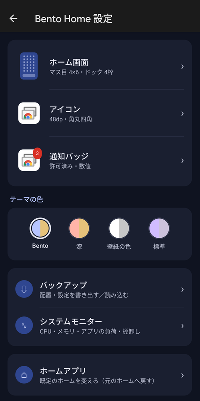
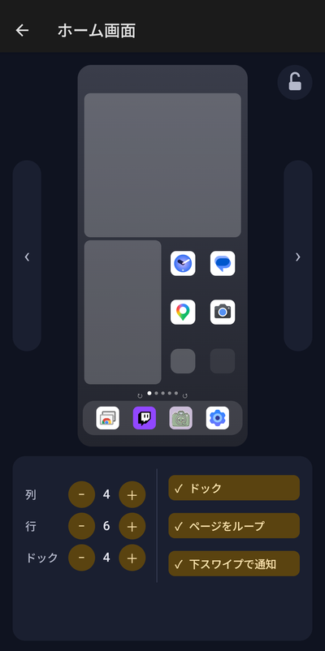
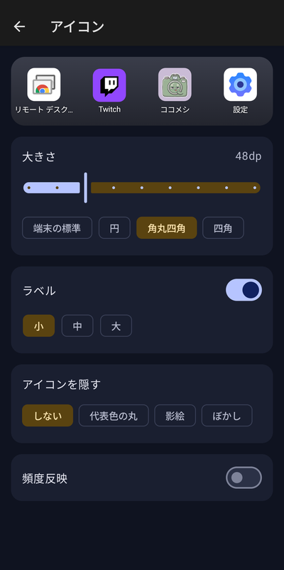
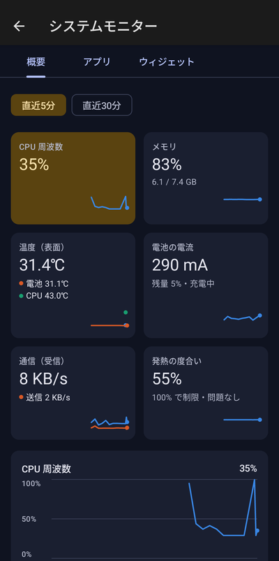
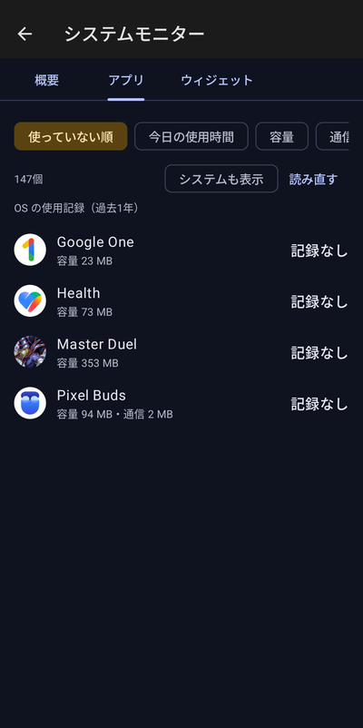
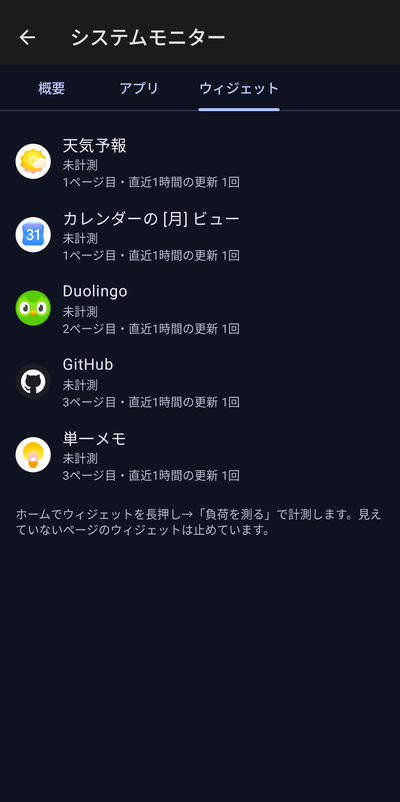

  

<h1 align="center">Bento Home</h1>

広告のない、自分で中身を把握できる Android のホームアプリ

---

スマホのホーム画面を置き換えるアプリです。弁当箱に具材を詰めるように、アイコンやウィジェットを好きな位置に並べられます。

<table>
  <tr>
    <td align="center"> 設定</td>
    <td align="center"> ホーム画面の設定</td>
    <td align="center"> アイコンの設定</td>
  </tr>
  <tr>
    <td align="center"> システムモニター</td>
    <td align="center"> アプリの使い方</td>
    <td align="center"> ウィジェットの負荷</td>
  </tr>
</table>

## できること

- **広告なし・通信なし:** インターネットの権限そのものを持っていません
- **自由に並べる:** アイコンは半マス単位で置け、空白や中央寄せもできます
- **使っていないアプリが分かる:** しばらく開いていないアプリは色が薄くなります（オフにもできます）
- **スマホの状態が見える:** CPU・メモリ・温度・電池や、アプリごとの使い方

## 入れ方

1. [Releases](https://github.com/kuronekorou39/bento-home/releases) から、最新の `bento-home-….apk` をスマホでダウンロードして開きます。
2. Bento Home を開き、画面の上の「Bento Home を既定のホームにする」を押します。

Google Play を通していないので、Play プロテクトやウイルス対策アプリが警告を出すことがあります。動作環境は Android 13 以降です。

## 資料

- [使い方](docs/guide.md): 操作、設定、システムモニター、困ったとき、プライバシー
- [運用手順](docs/operations.md): ビルド・署名・インストール・権限の付与（開発者向け）
- 設計: [plan.md](plan.md)、[docs/design.md](docs/design.md)、[docs/monitor.md](docs/monitor.md)

## ライセンス

[MIT](LICENSE)
