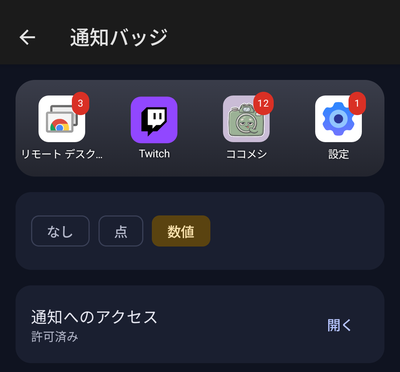

  

<h1 align="center">Bento Home</h1>

広告のない、自分で中身を把握できる Android のホームアプリ

---

Bento Home は、スマホのホーム画面（アプリのアイコンやウィジェットを並べる画面）を置き換えるアプリです。弁当箱に具材を詰めるように、アイコンやウィジェットを好きな位置に並べられます。

- **広告なし・通信なし。** インターネットに接続する権限そのものを持っていません。
- **自由に並べられる。** アイコンは半マス単位で置けて、空白や中央寄せもできます。
- **使っていないアプリが分かる。** しばらく開いていないアプリは、だんだん色が薄くなります（オフにもできます）。
- **スマホの状態が見える。** CPU・メモリ・温度・電池や、アプリごとの使い方をまとめて見られます。

> [!NOTE]
> 作者が自分の Pixel（Android 17）で使うために作っています。他の機種でも動くはずですが、確かめていません。

## 画面

<table>
  <tr>
    <td align="center"> 設定</td>
    <td align="center"> ホーム画面の設定</td>
    <td align="center"> アイコンの設定</td>
  </tr>
  <tr>
    <td align="center"> システムモニター</td>
    <td align="center"> アプリの使い方</td>
    <td align="center"> ウィジェットの負荷</td>
  </tr>
</table>

## できること

### ホーム画面

- アイコン・ウィジェット・フォルダーを好きな位置に置けます。置くと、重なる項目は自動でよけます。
- ページは何枚でも作れて、最後のページの次を最初のページにする（ループ）こともできます。
- 背景を長押しすると、ウィジェットの追加・ページの整理・配置のロックなどのメニューが出ます。
- アイコンを長押しすると、アプリのショートカット（例:「新しいアラーム」）や、ホームからの削除が出ます。
- 上にスワイプするとアプリ一覧、下にスワイプすると通知が開きます。

### 見た目

- アイコンの大きさ・形（円・角丸・四角）・名前の表示を変えられます。設定画面で、実際のアイコンを見ながら選べます。
- テーマの色を選べます（Bento・漆・壁紙の色・標準）。
- 通知の数をアイコンの右上に出せます（なし・点・数値）。

  

### システムモニター

ホームの背景を長押し →「システムモニター」で開きます。

- **概要:** CPU・メモリ・温度・電池の電流・通信量を、数字と小さなグラフで表示します。
- **アプリ:** 入っているアプリを「使っていない順」「容量」「電池」などで並べ替えられます。使わなくなったアプリの整理に使えます。
- **ウィジェット:** ホームに置いたウィジェットが、どれくらいスマホに負担をかけているかを測れます。

## はじめかた

### 1. インストールする

Google Play には出していません。APK ファイルを直接インストールします。

1. このページの右側にある「Releases」から、最新の `bento-home-….apk` をスマホでダウンロードします。
2. ダウンロードしたファイルを開きます。「提供元不明のアプリ」の許可を求められたら、表示に従って許可します。
3. Play プロテクトやウイルス対策アプリが警告を出すことがあります。ストアを通していないアプリには出る警告です。

### 2. ホームアプリにする

1. Bento Home を開くと、画面の上に「Bento Home を既定のホームにする」ボタンが出ます。押して「Bento Home」を選びます。
2. ホームボタンを押して、Bento Home が出れば完了です。

元のホームに戻したいときは、Bento Home の設定 →「ホームアプリ」から元のホーム（Pixel なら「Pixel Launcher」）を選びます。Android の設定 → アプリ → デフォルトのアプリ → ホームアプリ からでも戻せます。

### 3. 通知の数を出す（任意）

設定 →「通知バッジ」→「通知へのアクセス」の「開く」から、Bento Home に通知へのアクセスを許可します。

Bento Home は通知の**件数を数えるだけ**で、タイトルや本文は保存も記録もしません。出る数字は今出ている通知の件数で、アプリ内の未読数とは一致しないことがあります。

### 4. システムモニターで見られる情報を増やす（任意）

何もしなくても、CPU の周波数・メモリ・温度・電池などは見られます。アプリごとの使い方や、すべてのアプリの CPU・メモリを見るには、追加の許可が要ります。システムモニターの概要の一番下にある「表示できる情報を増やす」に、必要な手順とコマンドが出ます。

- **アプリの使い方:** Android の設定 → アプリ → 特別なアプリアクセス → 使用状況へのアクセス で Bento Home を許可します。
- **それ以上の情報:** adb というツールでコマンドを送る必要があります。パソコンがあれば手順は [docs/operations.md](docs/operations.md) にあります。パソコンが無い場合は、スマホだけでコマンドを送れる [Pocket Shell](https://github.com/kuronekorou39/pocket-shell) を使う方法もあります。

## プライバシー

- Bento Home はインターネットの権限を持たず、どこにもデータを送りません。
- アプリを開いた回数と日時は、このスマホの中だけに記録します（「使っていないアプリ」の判定に使います）。設定 → バックアップ →「使用履歴を削除」で消せます。
- Google のクラウドバックアップの対象外にしています。配置や設定を残したいときは、設定 →「バックアップ」から自分でファイルに書き出してください。

## 困ったとき

| 困っていること | どうするか |
|---|---|
| 更新したら「ホームアプリを選択」の画面が出た | 「Bento Home」を選び、「常時」を押します |
| 配置が動かせない・消せない | 配置のロックがかかっています。背景を長押し →「配置ロックを解除」、または設定 → ホーム画面の右上の鍵を押します |
| アイコンが薄い | しばらく開いていないアプリです。設定 → アイコン →「頻度反映」をオフにすると、薄くなりません |
| Bento Home が開けなくなった | Android の設定 → アプリ → デフォルトのアプリ → ホームアプリ で元のホームに戻せます |

## 開発者向け

- Kotlin と Jetpack Compose で書いています。`./gradlew assembleDebug` でビルドできます。
- 設計: [plan.md](plan.md)、[docs/design.md](docs/design.md)
- ビルド・署名・インストール・権限の付与: [docs/operations.md](docs/operations.md)
- システムモニターの仕組み: [docs/monitor.md](docs/monitor.md)

## ライセンス

[MIT](LICENSE)
