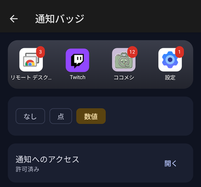

# Bento Home の使い方

[README](../README.md) の続きです。

## ホームアプリにする

1. Bento Home を開くと、画面の上に「Bento Home を既定のホームにする」ボタンが出ます。押して「Bento Home」を選びます。
2. ホームボタンを押して、Bento Home が出れば完了です。

元のホームに戻すときは、Bento Home の設定 →「ホームアプリ」から元のホーム（Pixel なら「Pixel Launcher」）を選びます。Android の設定 → アプリ → デフォルトのアプリ → ホームアプリ からでも戻せます。

## ホーム画面の操作

- アイコン・ウィジェット・フォルダーを長押しして運ぶと、好きな位置に置けます。重なる項目は自動でよけます。
- 背景を長押しすると、ウィジェットの追加・ページの整理・配置のロックなどのメニューが出ます。
- アイコンを長押しすると、アプリのショートカット（例:「新しいアラーム」）や、ホームからの削除が出ます。
- 上にスワイプするとアプリ一覧、下にスワイプすると通知が開きます。

## 設定

設定は、ホームの背景を長押し → ⚙ で開きます。

- **ホーム画面:** マス目の数、ドック、ページのループ、配置のロック
- **アイコン:** 大きさ・形・名前の表示・アイコンを隠す・頻度反映（しばらく開いていないアプリを薄くする）
- **通知バッジ:** 通知の数の出し方（なし・点・数値）
- **テーマの色:** Bento・漆・壁紙の色・標準

通知の数を出すには、設定 →「通知バッジ」→「通知へのアクセス」の「開く」から許可します。Bento Home は件数を数えるだけで、タイトルや本文は保存も記録もしません。出る数字は今出ている通知の件数で、アプリ内の未読数とは一致しないことがあります。

## システムモニター

ホームの背景を長押し → ∿ で開きます。

- **概要:** CPU・メモリ・温度・電池の電流・通信量
- **アプリ:** 入っているアプリを「使っていない順」「容量」「電池」などで並べ替え
- **ウィジェット:** ホームに置いたウィジェットの負荷

何もしなくても CPU の周波数・メモリ・温度・電池などは見られます。それ以上は許可が要ります。概要の一番下の「表示できる情報を増やす」に手順が出ます。

- **アプリの使い方:** Android の設定 → アプリ → 特別なアプリアクセス → 使用状況へのアクセス で Bento Home を許可します。
- **すべてのアプリの CPU・メモリなど:** adb でコマンドを送ります。パソコンなら [運用手順](operations.md)、パソコンが無ければ [Pocket Shell](https://github.com/kuronekorou39/pocket-shell) でスマホだけで送れます。

## 困ったとき

| 困っていること | どうするか |
|---|---|
| 更新したら「ホームアプリを選択」の画面が出た | 「Bento Home」を選び、「常時」を押します |
| 配置が動かせない・消せない | 配置のロックがかかっています。背景を長押し →「配置ロックを解除」、または設定 → ホーム画面の右上の鍵を押します |
| アイコンが薄い | しばらく開いていないアプリです。設定 → アイコン →「頻度反映」をオフにすると、薄くなりません |
| Bento Home が開けなくなった | Android の設定 → アプリ → デフォルトのアプリ → ホームアプリ で元のホームに戻せます |

## プライバシー

- インターネットの権限を持たず、どこにもデータを送りません。
- アプリを開いた回数と日時は、このスマホの中だけに記録します（「使っていないアプリ」の判定に使います）。設定 → バックアップ →「使用履歴を削除」で消せます。
- Google のクラウドバックアップの対象外です。配置や設定を残したいときは、設定 →「バックアップ」から自分でファイルに書き出してください。
